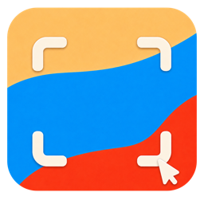

# Captures

**一款开源的 macOS 截图工具，把截图、标注、长截图、文字识别和悬浮对照放在一起。**

选中想截的内容，直接画箭头、加文字或打马赛克，再复制、保存、打开编辑器，或把截图挂在屏幕上继续工作。截图、OCR 和历史记录在本机处理，无需注册账号。

Open-source screenshot tool for macOS, with quick annotation, manual scrolling capture, on-device OCR, and floating screenshots.


[](LICENSE)
[](https://github.com/KunZhang1997/Captures/actions/workflows/ci.yml)



当前为 **0.0.1 开发版**。本仓库先公开源码与构建方式，尚未发布可供下载的安装包。功能仍在迭代；自动检查、签名构建和真实使用验证的范围见[验证记录](docs/publication-validation.md)。

## 能做什么

| 场景 | 使用方式 |
| --- | --- |
| 截取屏幕内容 | 截取区域、窗口或全屏；区域选择时可点击窗口，也可拖动框选 |
| 截完马上说明问题 | 在选区上直接画矩形、椭圆、箭头、画笔、文字或马赛克，支持撤销与重做 |
| 保存一段长内容 | 选择区域，手动滚动页面，由 Captures 拼接已确认的向下滚动内容 |
| 把图片里的字拿出来 | 使用 Apple Vision 在本机识别文字，再复制使用 |
| 边看边工作 | 将截图保留为悬浮窗口，按需置顶，方便对照资料 |
| 继续编辑图片 | 裁剪、旋转、标注、遮挡、加背景等；也可通过 `⌘O` 打开已有图片 |
| 回看之前的截图 | 使用本地历史记录，按文字或类型查找，配置保留时间与存储位置 |

界面支持简体中文与英文。应用常驻菜单栏，可在设置中调整快捷键、图片格式、保存目录和文件命名。

## 怎么用

1. 启动 Captures，在系统设置中授予「屏幕录制」权限。
2. 按 `⌘⇧A`，拖动选择区域，或点击高亮的窗口。
3. 根据需要在选区上标注，再选择复制、保存、OCR、编辑或悬浮。

手动长截图可以使用 `⌥⌘S`，也可以从尚未添加标注的选区进入。选好区域后，用鼠标或触控板向下滚动；选择复制、保存、OCR 或编辑时结束采集，关闭则取消。

| 默认快捷键 | 操作 |
| --- | --- |
| `⌘⇧A` | 区域截图 / 快速窗口选择 |
| `⌥⌘F` | 全屏截图 |
| `⌥⌘W` | 窗口截图 |
| `⌥⌘S` | 手动长截图 |
| `⌘O` | 打开图片进行编辑 |

截图快捷键可以在设置中修改。选区内的 `V / R / E / A / P / T / X` 分别用于选择标注、矩形、椭圆、箭头、画笔、文字和马赛克。

## 权限与数据

- **屏幕录制**：用于读取屏幕内容，截图功能需要此权限。
- **辅助功能**：可选，用于处理已经被其他应用占用的快捷键。未授权时使用系统快捷键注册并提示冲突。
- **数据存储**：截图历史与 OCR 在本机处理。应用数据默认保存在 `~/Library/Application Support/Captures/`，导出图片的位置可自行设置。

## 从源码构建

<a id="build-from-source"></a>

需要 macOS 14+、Xcode 16+、[XcodeGen](https://github.com/yonaskolb/XcodeGen) 和有效的 Apple Developer 签名证书。

```bash
git clone https://github.com/KunZhang1997/Captures.git
cd Captures
brew install xcodegen
xcodegen generate
open Captures.xcodeproj
```

在 Xcode 中选择 `Captures` scheme，在应用与测试 target 的 Signing 设置里选择自己的开发团队和有效 Apple 证书，然后构建运行。`project.yml` 中保留了维护者的签名默认值，其他开发者需要使用自己的配置。

命令行构建也可以显式覆盖签名设置：

```bash
xcodebuild build \
  -project Captures.xcodeproj \
  -scheme Captures \
  -configuration Debug \
  -destination 'platform=macOS' \
  DEVELOPMENT_TEAM=YOUR_TEAM_ID \
  CODE_SIGN_STYLE=Manual \
  CODE_SIGN_IDENTITY="Apple Development: Your Name (YOUR_CERTIFICATE_ID)"
```

将命令中的团队和证书占位符替换为自己的实际值。项目要求使用有效 Apple 身份签名。

## 开发与贡献

欢迎通过 [Issues](https://github.com/KunZhang1997/Captures/issues) 反馈问题，或提交 Pull Request。复现步骤、macOS 版本和不含个人信息的示例有助于定位问题。

| 目录 | 内容 |
| --- | --- |
| `Captures/` | 原生 macOS 应用：截图、选区标注、编辑器、OCR、悬浮窗口与历史记录 |
| `CapturesTests/` | 现有自动化测试 |
| `design/` | 统一交互原型与虚构示例素材 |
| `website/` | 可选的 Astro 介绍页源码，尚未配置本分支的正式域名 |
| `scripts/` | 发布产物验证脚本 |

[贡献说明](CONTRIBUTING.md)包括测试与签名要求。[原型说明](docs/prototype-guide.md)保留完整的视觉与交互约定。浏览原型时，在项目根目录运行：

```bash
python3 -m http.server 8123
```

然后访问 [All in One 原型](http://127.0.0.1:8123/design/all-in-one-prototype.html)。HTML 原型用于查看交互设计；原生应用的实际行为以源码、测试和使用验证为准。

## 来源与许可

本项目由 [KunZhang1997](https://github.com/KunZhang1997) 维护，基于 [Nick Shatilo 的 Snapper](https://github.com/nickshatilo/snapper) 修改，保留上游提交历史。当前分支使用 Captures 名称，继续调整截图后的标注、长截图、OCR、悬浮窗口、中文界面与图片编辑体验。

沿用上游 README 声明的 **MIT** 许可，完整文本见 [LICENSE](LICENSE)。上游署名与第三方组件说明见 [NOTICE](NOTICE)；内置 Filerobot Image Editor 的许可保留在 [ThirdPartyNotices.txt](Captures/Resources/ImageEditor/ThirdPartyNotices.txt)。
